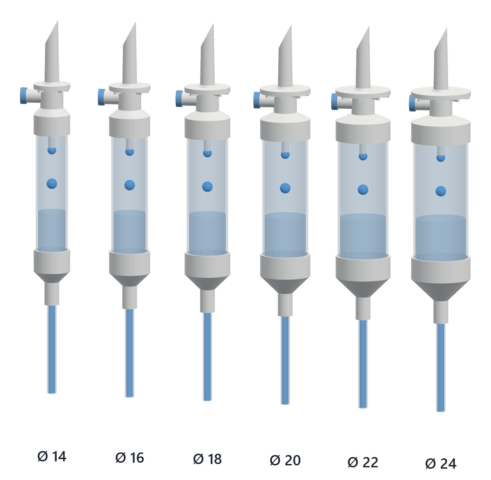
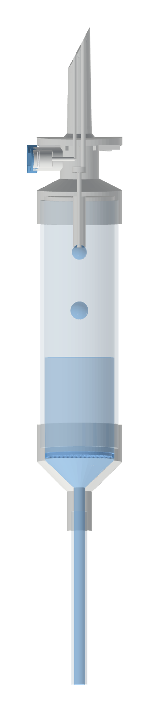

# IV drip chamber CAD

Ready-to-use 3D models of a gravity IV infusion drip chamber (macrodrip, 20 drops ≈ 1 mL) in six outer diameters from 14 to 24 mm, plus the parametric source for any other size.

Use them as reference geometry for clamps, drop sensors, holders and enclosures that mount on a drip chamber, for fit checks, renders and teaching.



## Contents

- [Download](#download)
- [Onshape](#onshape)
- [How a drip chamber works](#how-a-drip-chamber-works)
- [What is modelled](#what-is-modelled)
- [Dimensions and reference positions](#dimensions-and-reference-positions)
- [Regenerate or make other sizes](#regenerate-or-make-other-sizes)
- [Repository layout](#repository-layout)
- [Limitations](#limitations)
- [Contributing](#contributing)
- [License](#license)

## Download

GitHub previews the STL files in the browser. Click a link, then use *Download raw file*.

| Outer Ø | STEP (device) | STEP (with fluid and drops) | STL (device) |
|---|---|---|---|
| 14 mm | [step](models/d14/iv-drip-chamber-d14.step) | [step](models/d14/iv-drip-chamber-d14-with-fluid.step) | [stl](models/d14/iv-drip-chamber-d14.stl) |
| 16 mm | [step](models/d16/iv-drip-chamber-d16.step) | [step](models/d16/iv-drip-chamber-d16-with-fluid.step) | [stl](models/d16/iv-drip-chamber-d16.stl) |
| 18 mm | [step](models/d18/iv-drip-chamber-d18.step) | [step](models/d18/iv-drip-chamber-d18-with-fluid.step) | [stl](models/d18/iv-drip-chamber-d18.stl) |
| 20 mm | [step](models/d20/iv-drip-chamber-d20.step) | [step](models/d20/iv-drip-chamber-d20-with-fluid.step) | [stl](models/d20/iv-drip-chamber-d20.stl) |
| 22 mm | [step](models/d22/iv-drip-chamber-d22.step) | [step](models/d22/iv-drip-chamber-d22-with-fluid.step) | [stl](models/d22/iv-drip-chamber-d22.stl) |
| 24 mm | [step](models/d24/iv-drip-chamber-d24.step) | [step](models/d24/iv-drip-chamber-d24-with-fluid.step) | [stl](models/d24/iv-drip-chamber-d24.stl) |

**Which file?**

- **STEP (device)** for CAD work: an assembly of seven named, coloured solids. Import it into Fusion, SolidWorks, Onshape, FreeCAD or similar and design against the real faces.
- **STEP (with fluid and drops)** for renders and illustrations: the same assembly plus a fluid column and two drops as extra bodies.
- **STL (device)** for quick viewing, mesh tools and slicers: one mesh, every part watertight. STL carries no units; the values are millimetres.

## Onshape

Open the [public Onshape document](https://cad.onshape.com/documents/036ee7c603fcfc9991b4e10a/w/f269ac826d1c214e2cdabac3/e/6dd47121a96d592e15f63fe8). Pick the diameter from the *Chamber outer diameter* list at the top of the feature tree, then right-click a part or the Part Studio tab and choose *Export* (STEP, STL, Parasolid and more). A free Onshape account is enough and no parametrising is needed. To change other dimensions, use *Make a copy* and edit the feature.

To use the feature in your own documents, create a Feature Studio, keep the two header lines Onshape generates, paste [`onshape/iv_drip_chamber.fs`](onshape/iv_drip_chamber.fs) below them and commit. *IV drip chamber* then appears at the right end of the Part Studio toolbar.

| Feature parameter | Default | Range |
|---|---|---|
| Chamber outer diameter | 20 mm | 12–40 mm |
| Chamber wall | 1 mm | 0.5–3 mm |
| Chamber length | 63 mm | 30–150 mm |
| Drop former length | 13 mm | 5–40 mm |
| Tubing length | 44 mm | 5–300 mm |
| Show fluid and drops | on | |
| Fluid level above chamber bottom | 23 mm | 8–120 mm |

The feature and the Python script produce the same geometry; the bounding boxes of all six published sizes match to 0.1 mm.

## How a drip chamber works

The drip chamber sits between the infusion bag and the patient line of a gravity set.

1. The **spike** pierces the bag or bottle port. One lumen carries fluid down, the second lets air into rigid bottles through the **vent**, whose membrane keeps bacteria out.
2. Fluid leaves the **drop former** as single drops of a defined size. The bore sets the drop factor, here 20 drops ≈ 1 mL.
3. The drops fall through an air gap in the transparent **chamber**. Counting them gives the flow rate:
   `drops per minute = mL per hour × drop factor / 60`, so with 20 drops/mL, 1 drop per minute ≈ 3 mL/h.
4. The **fluid level** in the lower part keeps air out of the line. The **particle filter** above the outlet retains particles before the fluid enters the **tubing**.

Drop sensors usually look across the air gap between the drop former tip and the fluid level; the reference positions below give that zone.

## What is modelled



- **Spike** with a 62° bevelled tip and two lumens: fluid to the drop former, air to the side vent
- **Air vent** with membrane and slotted cap
- **Top cap** with finger flange, eight grip ribs and a socket for the chamber tube
- **Drop former**, outer Ø 3.2 mm, inner bore 1.1 mm (20 drops ≈ 1 mL class)
- **Chamber tube**, transparent, wall 1 mm
- **Bottom cap** with funnel, perforated particle filter and an outlet socket
- **Tubing**, inner Ø 2.9 mm, outer Ø 4.1 mm
- **Fluid and drops** (0.05 mL per drop), only in the *with fluid* STEP

Spike, vent, outlet and tubing stay the same for every diameter. Caps, flange, funnel and filter follow the chamber.

<br clear="right">

## Dimensions and reference positions

Units are millimetres. The chamber axis is Z with the spike pointing up; z = 0 is the lower end of the chamber tube, which sits inside the bottom cap socket.

| Outer Ø | Inner Ø | Cap Ø | Overall size (X × Y × Z) |
|---|---|---|---|
| 14 | 12 | 15.8 | 21.5 × 16.0 × 164.2 |
| 16 | 14 | 17.8 | 22.5 × 18.0 × 165.1 |
| 18 | 16 | 19.8 | 23.5 × 20.0 × 166.1 |
| 20 | 18 | 21.8 | 24.5 × 22.0 × 167.0 |
| 22 | 20 | 23.8 | 25.5 × 24.0 × 167.9 |
| 24 | 22 | 25.8 | 26.5 × 26.0 × 168.9 |

X includes the side vent, so the size is not symmetric about the axis.

Positions along Z, the same for every published size:

| Feature | z |
|---|---|
| Chamber tube | 0 to 63 |
| Bottom cap socket (covers the tube) | 0 to 6 |
| Top cap socket (covers the tube) | 57 to 63 |
| **Clear tube between the caps** | **6 to 57** |
| Drop former tip | 51 |
| Fluid level in the *with fluid* model | 23 |
| Free drop zone (drop former tip to fluid level) | 23 to 51 |
| Finger flange | 77 to 79 |
| Spike tip | 107 |

A clamp or sensor that grips the clear tube has 51 mm of height to work with. The drop former tip sits 6 mm below the top cap, inside the clear zone.

## Regenerate or make other sizes

Requires Python 3.10 or newer.

```
pip install -r requirements.txt
python src/drip_chamber.py --od 19.5
python src/drip_chamber.py --od 14 16 18 20 22 24 --length 70 --drop-former 15
```

| Option | Default | Meaning |
|---|---|---|
| `--od` | 20 | One or more chamber outer diameters |
| `--wall` | 1.0 | Chamber wall thickness |
| `--length` | 63 | Chamber tube length |
| `--drop-former` | 13 | Drop former length below the cap ceiling |
| `--tubing` | 44 | Tubing stub length |
| `--out` | `models/` | Output folder |

Files land in `<out>/d<diameter>/`. The script stops if a part is not a valid solid or its STL is not watertight, so every file it writes has passed both checks. Changing `--length` or `--drop-former` shifts the reference positions above accordingly.

## Repository layout

```
models/d14 … d24/   STEP and STL per diameter
src/                drip_chamber.py, the parametric generator (build123d)
onshape/            iv_drip_chamber.fs, the same model as an Onshape custom feature
docs/               preview images
```

## Limitations

- The dimensions are typical values chosen to match common ISO 8536-4 style gravity sets. They are **not** measured from, or based on drawings of, any manufacturer's product. Measure the set you actually use before relying on a fit.
- Real chambers are often slightly tapered or have a soft, flexible lower part; this model is a straight rigid tube.
- The perforated disk stands in for the filter mesh, and the vent membrane is a plain disk.
- **Not for clinical use.** These models are reference geometry for design and education, not a medical device design.

## Contributing

Measurements of real drip chambers are the most useful contribution: outer diameter, clear tube length and drop former position, with the set's drop factor. Open an issue with the values and, if possible, a photo next to a ruler. Bug reports for the script or the Onshape feature are welcome too.

## Related

[Dripito](https://github.com/Gluflex/iv-flow-monitor) is an open IV flow monitor that clips onto drip chambers of 14–24 mm, the range these models cover.

## License

Public domain. To the extent possible under law, Leandro Catarci has waived all copyright and related rights to this work under [CC0 1.0 Universal](LICENSE). This covers the models, the source code, the Onshape feature and the documentation.

You may copy, modify, distribute and use everything here, commercially or not, without asking and without crediting anyone. A link back is appreciated but not required.

The models come without any warranty (see the license text).
